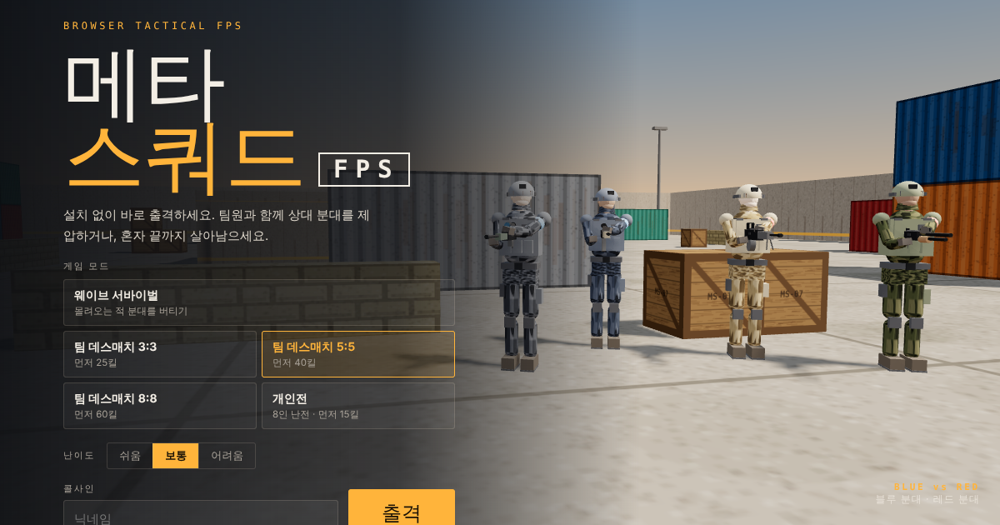

# 메타 스쿼드 FPS

설치 없이 브라우저에서 바로 즐기는 3D 분대 전투 FPS입니다. Three.js와 Vite로 만들었고, 정적 사이트로 빌드되므로 Vercel에 그대로 배포됩니다.



## 게임 모드

| 모드 | 규칙 |
| --- | --- |
| 팀 데스매치 3:3 | 블루 팀(나 + AI 2명) vs 레드 팀 3명, 먼저 25킬 |
| 팀 데스매치 5:5 | 먼저 40킬 |
| 팀 데스매치 8:8 | 먼저 60킬 |
| 개인전 | 8인 난전, 먼저 15킬 |
| 웨이브 서바이벌 | 웨이브마다 강화 카드 선택, 5웨이브마다 보스 |

팀전과 개인전은 8분 시간 제한이 있으며, 시간이 끝나면 점수가 높은 쪽이 이깁니다. 쓰러지면 4초 뒤 리스폰되고, 리스폰 직후 2초간 보호됩니다.

## 무기

경기 중 언제든 **B**로 무기고를 열어 실시간으로 바꿀 수 있습니다. 쓰러진 적이 떨어뜨린 총은 **E**로 주워 즉시 교체합니다.

- **주무기:** K-9 카빈, VX-4 돌격소총, 스팅어 SMG, T-12 펌프 샷건, M-21 지정사수소총(스코프), 롱보우 저격소총(스코프), 해머 경기관총
- **권총:** P-17 권총, .44 매그넘, MP-9 기관권총
- **근접:** 전투 나이프(뒤에서 찌르면 즉사)
- **투척물:** 세열 수류탄(G), 섬광탄(F), 연막탄(V)

## 조작

| 키 | 동작 |
| --- | --- |
| W A S D / Shift / Space / C | 이동 / 달리기 / 점프 / 앉기 |
| 좌클릭 / 우클릭 | 사격 / 조준 |
| 1 2 3, 휠 | 주무기 · 권총 · 나이프 |
| R | 재장전 |
| G F V | 세열 · 섬광 · 연막 |
| B / E | 무기고 / 총 줍기 |
| Q | 오버드라이브 |
| Tab / Esc / M | 점수판 / 일시정지 / 소리 |

모바일에서는 가상 조이스틱과 터치 버튼이 표시됩니다.

## 로컬 실행

```bash
npm install
npm run dev      # http://localhost:5173
npm run build    # dist/ 에 정적 파일 생성
npm run preview
```

## Vercel 배포와 도메인 연결

1. 이 저장소를 GitHub에 올립니다.
2. [vercel.com/new](https://vercel.com/new)에서 저장소를 Import합니다. `vercel.json`에 설정이 있어 Framework(Vite), Build(`npm run build`), Output(`dist`)이 자동으로 잡힙니다.
3. 프로젝트 **Settings → Domains**에 도메인을 추가합니다.
   - 루트 도메인(`example.com`): DNS에 `A` 레코드 `76.76.21.21`
   - 서브도메인(`play.example.com`): DNS에 `CNAME` 레코드 `cname.vercel-dns.com`
   - Vercel 화면에 표시되는 값이 위와 다르면 그 값을 따르세요.
4. 도메인이 연결되면 `index.html`의 `og:image`를 `https://도메인/og.png` 절대 주소로 바꾸면 메신저 미리보기가 더 안정적으로 표시됩니다.

이후 `main` 브랜치에 push할 때마다 Vercel이 자동으로 다시 배포합니다.

## 구조

```
src/
  main.js      게임 흐름, 모드, AI, 투척물, HUD, 메뉴
  weapons.js   총기 데이터와 절차적 총기·1인칭 모델
  soldier.js   절차적 병사 모델(관절별 드로우콜 병합)
  world.js     맵, 충돌, 시야(연막 포함), 스폰
  fx.js        파티클, 폭발, 연막 구름, 조명 풀
  audio.js     Web Audio 합성 효과음
  textures.js  캔버스 절차 텍스처
  core.js      렌더러, 카메라, 설정
```

기록과 설정은 브라우저 localStorage에만 저장됩니다. 실제 사람끼리 하는 온라인 대전은 실시간 서버(WebSocket)가 필요하며, 현재 버전의 팀원과 상대는 AI입니다.
